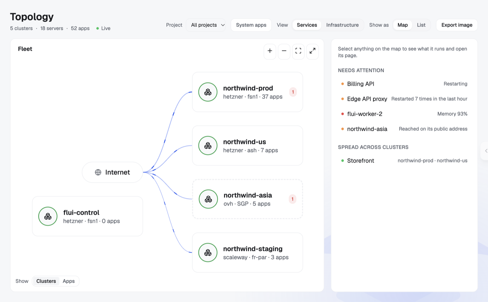

<p align="center">
  <picture>
    <source media="(prefers-color-scheme: dark)" srcset=".github/assets/logo-dark.png">
    
  </picture>
</p>
<h1 align="center">Flui Dashboard</h1>

<p align="center">
  <strong>The web console for Flui, the cloud platform you build on the providers you choose and on servers you own.</strong>
</p>
<p align="center">
  <a href="LICENSE"></a>
  <a href="https://github.com/flui-cloud/flui-dashboard/actions/workflows/docker-publish.yml"></a>
  
  
</p>
<p align="center">
  <a href="https://flui.cloud">Website</a> ·
  <a href="https://docs.flui.cloud">Docs</a> ·
  <a href="https://github.com/flui-cloud/flui-core">flui-core</a> ·
  <a href="https://github.com/flui-cloud/flui-spec">flui.yaml spec</a>
</p>

<p align="center">
  <picture>
    <source media="(prefers-color-scheme: dark)" srcset=".github/assets/topology-dark.png">
    
  </picture>
</p>

This is the web interface of [Flui](https://github.com/flui-cloud/flui-core). It ships with every Flui installation, runs on your own infrastructure and talks only to your own Flui API. There is no hosted tenant in front of it and no telemetry leaving your network.

The dashboard, the `flui` CLI and AI agents over MCP are clients of the same API, so anything you start in one you can follow in the others.

If Flui is useful to you, a ⭐ on [flui-core](https://github.com/flui-cloud/flui-core) helps other people find it.

## What's inside

- **Topology**: every cluster, server and application on one map, with live traffic and what needs attention.
- **Applications**: deploy from a repository, a framework template, the catalog or your own `flui.yaml`; follow builds, releases, logs, metrics and crashes; scale, restart and roll back.
- **Databases**: backups and point-in-time recovery, connection pooling, active sessions, an SQL console and migration between clusters.
- **Clusters and infrastructure**: servers, networks, firewalls, DNS and certificates across providers, with scaling groups that grow and shrink within a spending cap.
- **Agents**: keys for AI agents limited to what they need, and the approvals they ask for before they change anything.
- **Access**: projects, people and what each of them can see and do.
- **Providers and settings**: cloud keys, image registry, mail, backups and platform updates.

## Quickstart

The dashboard comes up with every Flui installation. To create one:

```bash
npm install -g @flui-cloud/cli
flui vault init
flui config set hetzner
flui env create --provider hetzner --region nbg1 --node-size cx23
```

The [install page](https://flui.cloud/#install) builds these commands for other providers, regions and your own servers.

## Local development

The dashboard talks to a running Flui installation:

```bash
# 1. Wire the endpoints and sign-in configuration into src/assets/config.json
flui env export-config --dashboard-path .

# 2. Install and run the dev server
pnpm install
pnpm start                # http://localhost:4200
```

Working against an API running on your machine? [`flui dev creds` and `flui dev tunnel`](https://docs.flui.cloud/cli/dev-tools/) wire the credentials and open the tunnels you need.

Other helpers:

```bash
pnpm run api:generate     # regenerate the typed API client from a running backend
pnpm run build            # production build
```

**Stack:** Angular standalone components, Signals for state, Spartan UI on TailwindCSS, strict TypeScript, and an API client generated from the Flui OpenAPI spec.

## Architecture

The dashboard is a pure client of the Flui API. It makes no provider calls of its own, keeps no server-side state and has no auth backend of its own: sign-in goes through the identity service that runs inside your Flui installation.

## Status

Flui is in **alpha**. The dashboard is used every day, but the surface is large: expect the interface to keep changing as the API settles.

## Contributing

Issues and pull requests are welcome. For larger changes, open an issue first. Bugs that are not about the interface go to [flui-core](https://github.com/flui-cloud/flui-core/issues).

## License

[GNU Affero General Public License v3](LICENSE).
